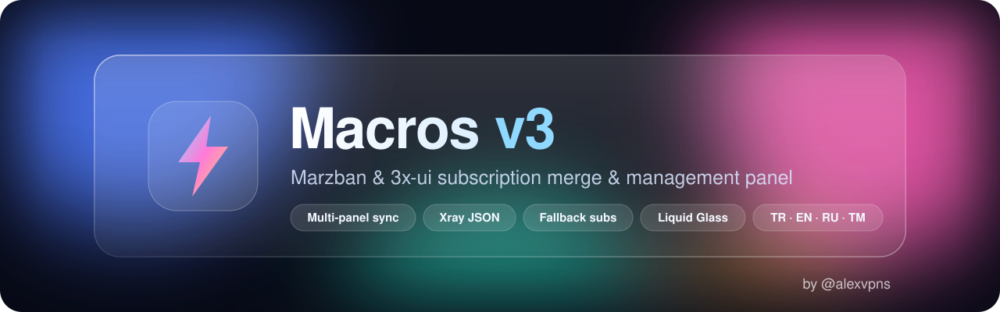
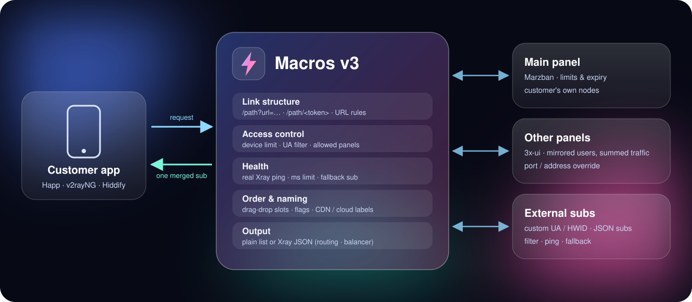

<p align="center">
  
</p>

<p align="center">
  <a href="https://github.com/Alexander-official/Macros-v3/releases"></a>
  
  
  
  <a href="https://t.me/alexvpns"></a>
</p>

<p align="center">
  <b>🇹🇷 <a href="#-türkçe">Türkçe</a></b> &nbsp;·&nbsp; <b>🇬🇧 <a href="#-english">English</a></b> &nbsp;·&nbsp; <b>🇷🇺 <a href="#-русский">Русский</a></b>
</p>

<p align="center">
  
</p>

---

## 🇹🇷 Türkçe

**Macros v3**, müşterilerinin sub linkini kendi alan adın üzerinden sunar ve şunları **tek, sıralı, düzgün isimlendirilmiş** bir abonelikte birleştirir:
müşterinin kendi kodları · diğer panellerindeki kodları · harici kaynaklar. Uygulamaya göre düz liste ya da tam **Xray JSON** verir.

### ✨ Özellikler

<table>
<tr>
<td width="50%" valign="top">

**🔗 Link yapısı — her şey ayarlanabilir**
- `/<yol>?url=<kaynak>` — istediğin kadar sub yolu (eski `/alexander77` gibi)
- `/<yol>/<token>` — **token linkleri**: müşteri panel adresini hiç görmez
- **Domain / URL şeması**: link aynı kalır, kaynak gerçek adresten çekilir (ör. `:8000` → `:443`)
- **Link oluşturucu**: bir linki yapıştır, tüm eşdeğer biçimleri kopyala
- **Kaynak tarama**: müşteri linklerindeki adresler denenir; cevap vermeyene tek tıkla kural önerilir
- Hepsi panelden canlı değişir, yeniden başlatma gerekmez

</td>
<td width="50%" valign="top">

**🛰️ Çoklu panel (Marzban + 3x-ui)**
- Ana paneldeki kullanıcılar 3x-ui'de **tüm inbound'larla** açılır
- Limit/süre ana panelden, trafik tüm panellerin **toplamı**
- 👁 **Önizleme**: panel eklerken kodları müşteriye gideceği haliyle gör
- 🔌 **Port / adres değiştirme**: inbound `8443` → config'te `443` (panele dokunulmaz)
- Senkron asla kullanıcı silmez

</td>
</tr>
<tr>
<td valign="top">

**🧩 Slotlar (sürükle-bırak)**
- Harici sub: protokol filtresi, **gerçek Xray ping**, ms limiti
- ↪ **Fallback sub**: ana engellenirse ya da kodları ölürse yedeğe geçer
- 📱 Özel **User-Agent** + 🆔 **HWID** ile çekme (Happ tarzı)
- 📍 Kaynak Sub ve 🔗 Panel blokları, slot başına sıralama
- Final önizleme

</td>
<td valign="top">

**🎨 Panel**
- 10 tema, aralarında ayarlanabilir 💧 **Liquid Glass**
- **TR / EN / RU / TM** — sunucu mesajları ve loglar dahil tam çeviri
- Telefon uyumlu, hızlı (dashboard gzip + kartlar açılınca çizilir)
- Cihaz limiti, UA kara/beyaz liste, istatistik ve loglar
- JSON çıktı: direct siteler, reklam engelleme, otomatik balancer

</td>
</tr>
</table>

### 🚀 Kurulum
Gereksinimler: Ubuntu 22.04+ / Debian 12+, root, sunucuya yönlenmiş bir alan adı, boş 80/443, en az 1 GB RAM.

```bash
apt update && apt install -y git
git clone https://github.com/Alexander-official/Macros-v3.git /opt/macros
cd /opt/macros && sudo ./install.sh
```

Sihirbaz domain, SSL e-postası, admin kullanıcı/şifre ve (isteğe bağlı) Marzban bilgilerini sorar; Python ortamını, Xray-core'u, `macros2` servisini, Nginx'i ve Let's Encrypt SSL'i kendisi kurar.

- **Panel:** `https://sub.domain.com/panel/login`
- **Müşteri linki:** `https://sub.domain.com/macros?url=https://panel.domain.com:8000/sub/XXXX`

### ⬆️ Güncelleme (eski sürüm dahil)
Sunucuda zaten Macros varsa `install.sh` bunu algılar ve **kurulum yerine güncelleme** yapar:

```bash
git clone https://github.com/Alexander-official/Macros-v3.git /root/macros-new
cd /root/macros-new && sudo ./install.sh
```

- `macros.db` (müşteriler, cihazlar, ayarlar) ve `.env` **korunur**; `.env`'e sadece eksik ayarlar eklenir
- Önce `backups/` altına kod + veritabanı yedeği alınır
- Eski sürümdeki sub yolları (ör. `/alexander77`) ve bot token'ı otomatik taşınır
- Nginx / SSL'e dokunulmaz; yeni sürüm açılmazsa **otomatik eski sürüme dönülür**

### 🔗 Link yapısı
Asıl önemli olan panelin `/sub/<token>` kısmı; gerisini **⚙️ Ayarlar → 🔗 Link Yapısı** bölümünden sen belirlersin.

| Biçim | Örnek | Ne zaman |
|---|---|---|
| Sub yolu | `https://sub.domain.com/alexander77?url=https://fin.domain.ru:8000/sub/TOKEN` | Eski linkler bozulmasın |
| Token linki | `https://sub.domain.com/fin/TOKEN` → kaynak `https://fin.domain.ru/sub/{token}` | Müşteri panel adresini görmesin; panel taşınınca sadece şablon değişir |
| Kısa link | `https://sub.domain.com/macros/KISA-TOKEN` | Macros'un kendi kısa kimliği |
| URL kuralı | `fin.domain.ru:8000` → `fin.domain.ru` | Link aynı kalsın, kaynak yeni adresten gelsin |

> **Link oluşturucu** ile bir müşteri linkini yapıştırıp tüm biçimleri tek tıkla kopyalayabilirsin.

### ⚙️ İlk ayarlar
1. **⚙️ Ayarlar → Harici Sub Kaynakları:** 📍 Kaynak Sub Bloğu ekle (müşterinin kendi kodları).
2. **+ Yeni Kaynak:** harici sub URL'si, gerekirse fallback, UA ve HWID.
3. **Entegre Paneller:** 3x-ui için API token gerekir (*3x-ui → Ayarlar → Güvenlik → API Token*). ⚡ test edince önizleme açılır; portları burada değiştirebilirsin.
4. **💾 Kaydet**, ardından **👁 Final Önizleme**.

### 🔧 Yapılandırma (`.env`)

| Değişken | Açıklama |
|---|---|
| `ADMIN_USER`, `ADMIN_PASS` | Panel girişi. Şifre boşsa her açılışta rastgele üretilip loga yazılır. |
| `MARZBAN_URL`, `MARZBAN_USER`, `MARZBAN_PASS` | Ana panel (opsiyonel) |
| `EXTRA_SUB_PATHS` | Ek sub yolları, virgülle (panelden de eklenebilir) |
| `MACROS_DB` | Veritabanı yolu (varsayılan: kurulum dizinindeki `macros.db`) |
| `BOT_TOKEN`, `BOT_CHAT_ID` | Opsiyonel Telegram izleme/yedek botu (`bot.py`) |

Değişiklikten sonra: `systemctl restart macros2`

<details>
<summary><b>❓ Sık sorulanlar</b></summary>

**Servis durumu / loglar?** `systemctl status macros2` · `journalctl -u macros2 -f`

**Şifremi unuttum.** `.env` → `ADMIN_PASS`'ı değiştir, sonra `systemctl restart macros2`.

**SSL alınamadı.** Domainin bu sunucuya yönlendiğini kontrol et: `certbot --nginx -d sub.domain.com`

**Ping testi çalışmıyor.** `xray/xray` var mı bak; yoksa `install.sh`'ı tekrar çalıştır.

**Gecikme kimden ölçülüyor?** Sunucudan; telefondaki değer farklı olabilir.

**Panel kasıyor.** Zayıf cihazda 💧 menüsünden "Kenar kırılması"nı kapat ya da başka tema seç.

</details>

<details>
<summary><b>📁 Dosya yapısı / kaldırma</b></summary>

```
main.py            Uygulama (FastAPI)
templates/         Panel sayfaları
static/            Liquid Glass + mobil stiller
assets/            README görselleri
install.sh         Kurulum + güncelleme
backup.sh          Yedekleme
bot.py             Opsiyonel Telegram botu
healthcheck.sh     Opsiyonel bekçi
.env.example       Örnek ayar dosyası
```
`macros.db` (veritabanı) ve `.env` (şifreler) kurulumda oluşur, repoda **yoktur**.

```bash
systemctl disable --now macros2
rm /etc/systemd/system/macros2.service /etc/nginx/sites-enabled/macros2 /etc/nginx/sites-available/macros2
systemctl restart nginx
rm -rf /opt/macros        # önce ./backup.sh ile yedek alın
```
</details>

---

## 🇬🇧 English

**Macros v3** serves your customers' sub links through your own domain and merges the customer's own nodes, nodes from your other panels and external sources into **one sorted, well-named subscription** — as a plain list or full **Xray JSON**, depending on the app.

**Highlights**
- **Link structure, fully configurable:** any number of sub paths (`/<path>?url=…`), **token links** (`/<path>/<token>`, the panel address is never exposed), **domain / URL rules** (link stays the same, the source is fetched from the real address, e.g. `:8000` → `:443`) and a **link builder**. All changes apply live.
- **Multi-panel (Marzban + 3x-ui):** users mirrored to 3x-ui on all inbounds, limits from the main panel, traffic summed, never deletes users. **Preview** a panel's nodes and **override ports / address** (e.g. inbound `8443` → `443` in client configs only; the panel is never modified).
- **Drag-and-drop slots:** external subs with real Xray latency test, ms limit, **fallback sub**, custom **User-Agent + HWID**; source / panel blocks; per-slot sorting; final preview.
- **Panel:** 10 themes incl. 💧 Liquid Glass, **TR / EN / RU / TM** fully translated, mobile-friendly and fast.

**Install** (Ubuntu 22.04+ / Debian 12+, root, a domain pointing to the server):
```bash
apt update && apt install -y git
git clone https://github.com/Alexander-official/Macros-v3.git /opt/macros
cd /opt/macros && sudo ./install.sh
```
- **Panel:** `https://<domain>/panel/login`
- **Sub link:** `https://<domain>/macros?url=<original-sub-link>`

**Update:** run `install.sh` from a fresh clone. If Macros is already installed (any older version) it updates in place: database and `.env` are kept, a backup is taken first, old sub paths are preserved, nginx/SSL are untouched, and it rolls back automatically if the new version fails to start.

---

## 🇷🇺 Русский

**Macros v3** отдаёт подписки ваших клиентов через ваш домен и объединяет собственные узлы клиента, узлы с других ваших панелей и внешние источники в **одну отсортированную подписку с аккуратными названиями** — обычным списком или полным **Xray JSON**, в зависимости от приложения.

**Возможности**
- **Структура ссылок настраивается полностью:** любые пути саба (`/<путь>?url=…`), **ссылки по токену** (`/<путь>/<токен>` — адрес панели клиент не видит), **правила домена / URL** (ссылка у клиента не меняется, источник берётся с реального адреса, напр. `:8000` → `:443`) и **конструктор ссылок**. Изменения применяются сразу, без перезапуска.
- **Несколько панелей (Marzban + 3x-ui):** пользователи главной панели создаются в 3x-ui на всех inbound'ах, лимиты берутся с главной, трафик суммируется, пользователи никогда не удаляются. **Предпросмотр** узлов панели и **замена порта / адреса** (напр. inbound `8443` → `443` только в конфигах клиентов, панель не трогается).
- **Слоты (drag-and-drop):** внешние сабы с реальным пингом через Xray, лимитом мс, **резервным сабом**, своим **User-Agent + HWID**; блоки исходного саба и панелей; сортировка по слотам; итоговый предпросмотр.
- **Панель:** 10 тем, включая 💧 Liquid Glass, **TR / EN / RU / TM** — полный перевод, включая сообщения сервера и логи; удобно на телефоне.

**Установка** (Ubuntu 22.04+ / Debian 12+, root, домен направлен на сервер):
```bash
apt update && apt install -y git
git clone https://github.com/Alexander-official/Macros-v3.git /opt/macros
cd /opt/macros && sudo ./install.sh
```
- **Панель:** `https://<домен>/panel/login`
- **Ссылка клиента:** `https://<домен>/macros?url=<исходная-ссылка-саба>`

**Обновление:** запустите `install.sh` из свежего клона. Если Macros уже установлен (любая старая версия), он обновится на месте: база и `.env` сохраняются, сначала делается резервная копия, старые пути сабов сохраняются, nginx/SSL не трогаются, а если новая версия не запустится — автоматический откат.

---

<p align="center">
  <b>Lisans / License / Лицензия:</b> ticari, kaynak kodu açık · commercial, source-available · коммерческая, исходный код открыт — <a href="LICENSE">LICENSE</a><br>
  <b>Destek / Support / Поддержка:</b> <a href="https://t.me/alexvpns">Telegram @alexvpns</a>
</p>
